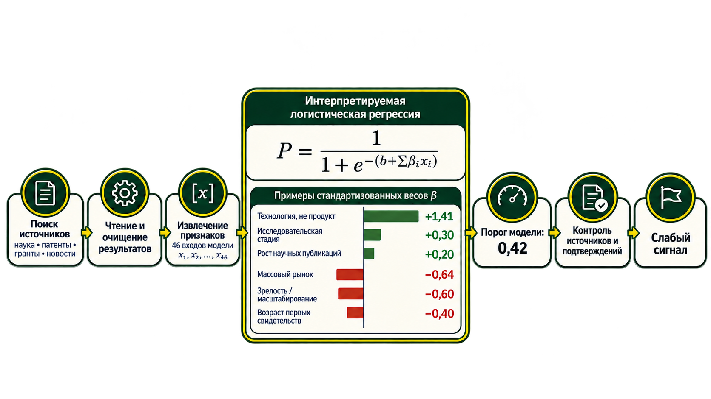

<table align="center" border="0" cellpadding="0" cellspacing="0">
  <tr><td align="center" bgcolor="#052e27">
    
  </td></tr>
</table>

# IDEA

## Технологический радар

Главная страница открывает поиск ранних технологических сигналов: многоязычный план → открытые источники → чтение документов → кандидаты → проверка зрелости → финальный ТОП-15 кандидатов и отчёты. Сначала в списке идут подтверждённые слабые сигналы по убыванию уверенности; затем, если их меньше 15, остальные кандидаты также по убыванию уверенности. Исходный статус каждого сохранён. Исходное приложение гипотез сохранено на `/lab`.

<p align="center">
  
</p>

### Быстрый запуск

```bash
cp .env.example .env
# Заполните OPENROUTER_API_KEY в .env
docker compose up --build -d
```

Откройте [http://localhost:8080](http://localhost:8080). Compose запускает PostgreSQL, API,
сервис веб-поиска и SearXNG. Пример `.env` задаёт `openai/gpt-5.6-luna` для основных вызовов радара
и отдельную модель для роли Research/web-search. Это идентификаторы моделей OpenRouter, прямые
вызовы OpenAI API не выполняются. Для локальной LLM задайте `RADAR_PROVIDER=local`. Веб-поиск и открытые источники
при этом всё равно требуют доступа к интернету.

Без ключа доступны интерфейс, каталог примеров и сохранённые исследования. Облачный поиск
показывает понятную ошибку настройки, а не вымышленные результаты. Каталог и авторские оценки не
используются как готовые ответы нового поиска.

Для запуска радара на локальной модели без OpenRouter используйте
[короткую пошаговую инструкцию](docs/13-local-deployment.md).

### Локальная разработка

```bash
cp .env.example .env
# Укажите OPENROUTER_API_KEY в .env
uv venv .venv --python 3.12
uv pip install --python .venv/bin/python -r requirements-dev.txt
cd frontend && npm ci && npm run build && cd ..
.venv/bin/python -m uvicorn app.main:app --host 127.0.0.1 --port 8080
```

Конфигурация радара читает `.env` при запуске каждого нового поиска. При пустом `RADAR_DATABASE_URL` используется явно обозначенное в API локальное SQLite-хранилище `storage/radar.db`; для стенда Compose задаёт PostgreSQL. Один процесс Uvicorn управляет заданиями. Несколько независимых API workers пока не поддерживаются. Незавершённые задания после рестарта помечаются прерванными и могут быть повторены.

### Запуск в Docker Compose

```bash
cp .env.example .env            # ключ: OPENROUTER_API_KEY (или RADAR_PROVIDER=local — без внешнего API)
docker compose up -d --build    # PostgreSQL + API + интерфейс, http://127.0.0.1:8080
```

Порт меняется `RADAR_PORT` (например, `RADAR_PORT=8092 docker compose up -d`). Запуски, источники
и оценки хранятся в PostgreSQL, кэш признаков — в `storage/feature_cache`.

### Интерфейс (React)

Интерфейс — `frontend/` (Vite + React + TypeScript), подробности в `frontend/README.md`.
Локально: `cd frontend && npm ci && npm run build`, затем запуск API как обычно — интерфейс
откроется на `/`. В Docker собирается автоматически. Прежняя страница доступна на `/legacy`.

### Поиск кандидатов

Каждая ветка плана ищется общим веб-поиском и специализированными коннекторами. Веб-поиск — сервис
`app/search` (Compose-контейнер `search`): провайдеры задаются через `SEARCH_PROVIDERS` (SearXNG,
Tavily, Exa, Brave, Yandex, OpenSERP или веб-плагин OpenRouter). Специализированные каналы
включают Crossref, arXiv, новости, патенты, грантовые и закупочные реестры, финансовые источники,
репозитории и медицинские реестры. Среди коннекторов есть NIH RePORTER, CORDIS, TED, NSF,
Grants.gov, UKRI, USAspending, SEC EDGAR, венчурные новости, Y Combinator, Google/EPO patents и
Роспатент. Часть адаптеров требует ключа или подходит только отдельным темам; образец `.env`
включает `RADAR_EXTRA_CONNECTORS=all`. Полный список и ограничения — в
[docs/11-search.md](docs/11-search.md).

План поиска использует приоритетные локали и язык исходной темы, если он распознан. Это широкий
мультиязычный охват, а не буквальный запрос к каждому источнику на всех языках мира. OpenAlex в
образце выключен из-за повторных `429` (`OPENALEX_ENABLED=1` включает его вручную). Google Patents
BigQuery удалён; FreePatentsOnline и веб-поиск Google Patents используются в предусмотренных
сценариях. Ошибки и пустые выдачи отражаются в аудите прогона.

В `.env.example` включён расширенный режим: 8 направлений, до 256 источников и 80 кандидатов.
Код допускает настройку до 16 направлений, 512 источников и 128 кандидатов; для веб-поиска можно
задать до 15 языковых формулировок на уточнение и до 20 результатов на формулировку. Фактический
объём зависит от выдачи и ограничений внешних поисковиков. Открытые коннекторы можно отключить через
`RADAR_OPEN_SOURCES=0`.

ТОП-15 сначала включает слабые сигналы по убыванию уверенности, затем дополняется остальными
проверенными кандидатами по убыванию уверенности. В нём сохраняется вердикт проверки: зрелость,
нерелевантность или недостаточность доказательств не превращаются в позитивную метку. Отдельная
вкладка показывает только слабые сигналы. Кандидаты одной технологии, найденные
среди подтверждённых слабых сигналов, склеиваются; дополнительные применения остаются у лидера.

### Конвейер ETL и устойчивость источников

Сборщик приводит ответы коннекторов и загруженные страницы к общей записи источника, сохраняет
извлечённый текст, метаданные, хэш входного содержимого и версию парсера, затем связывает документ
с кандидатами и оценками. Временные сетевые ошибки повторяются ограниченное число раз; повторные
сбои временно открывают circuit breaker для API-коннектора или домена статьи, а другие источники
продолжают обрабатываться. Результаты и статусы каналов сохраняются вместе с прогоном. Подробности,
включая границы хранения исходного ответа, описаны в [ETL-документации](docs/09-etl.md).

Обучающие наборы и их состав описаны в [docs/08-dataset.md](docs/08-dataset.md). Обычный поиск
не добавляет строки в обучение и не переобучает модель автоматически.

### Скоринг обученной моделью

Оценку кандидата рассчитывает логистическая регрессия. Проверенный локальный API на 20 октября 2026 года сообщил об артефакте logreg_v1: 46 входов и порог 0,42; его параметры и метрики описаны в [отчёте](docs/12-final-metrics.md), а различия конфигураций — в [настройках модели](docs/10-model-configuration.md). Фактически загруженный артефакт и число входов можно проверить через /api/radar/config. В текущей локальной конфигурации API также возвращает предупреждение о несовпадении LLM извлечения признаков и модели обучения, поэтому сохранённые метрики не подтверждают качество именно этой пары настроек.



Признаки извлекаются по научным, медийным и структурированным свидетельствам, включая финансирование. Перечень фактических входов зафиксирован в артефакте модели и описан в [каталоге признаков](docs/05-features.md). Отдельный поиск патентов может добавлять документы и данные в годовую диаграмму; патентных входов в действующем наборе скоринга нет. Статус кандидата также зависит от соответствия теме, подтверждённых цитат и проверки источников. Обычный поиск не переобучает модель автоматически.

### Локальная модель без внешнего API

Пошаговый запуск радара через Docker Compose и Ollama описан в
[инструкции локального развёртывания](docs/13-local-deployment.md). Вместо Ollama можно настроить
другой OpenAI-совместимый сервер; выбор модели и скорингового артефакта описан в
[настройках моделей](docs/10-model-configuration.md). Веб-поиск и открытые источники при этом
продолжают обращаться в интернет.

### Проверка

```bash
.venv/bin/python -m pytest -q
.venv/bin/ruff check app/radar tests scripts
node --check app/static/radar.js
```

Основные API: `POST /api/searches`, `GET /api/searches/{id}`, `GET /api/searches/{id}/signals`, `GET /api/searches/{id}/rejected`, `GET /api/signals/{id}`, `GET /api/catalog`. Выгрузка: `/api/searches/{id}/export.md` и `.json`. Автоматические тесты используют контролируемые ответы провайдера и не расходуют API-бюджет. Живой прогон проверяется отдельно.

### Проверяемость и ограничения

- Сохраняются прочитанные тексты, URL, даты при наличии, язык, тип, источник оценки доверенности и журнал вызовов моделей.
- Прямые цитаты проверяются на наличие в документе. Это подтверждает происхождение текста, а не истинность заявления автора.
- Оценка — калиброванная вероятность из загруженного артефакта логистической регрессии; активные входы и порог доступны в /api/radar/config. При `RADAR_USE_MODEL=0` используется отдельный фиксированный режим оценки.
- Будущие публикации исключаются. При историческом срезе исключаются также материалы с неизвестной датой. Текущая версия страницы не является архивной исторической копией.
- Повторные тексты объединяются консервативно; независимость всех публикаций автоматически не гарантируется.
- Недоступные документы, недостаточное покрытие и прерванные этапы видны пользователю. Список включает до 15 сформированных кандидатов; если после поиска и проверки кандидатов меньше 15, показывается фактически найденное число.
- Кэш источников хранится в `storage/source_cache`; возраст задаётся `RADAR_CACHE_HOURS`. Кэшированные материалы явно отмечаются.
- По умолчанию стенд привязан к `127.0.0.1`. Для общего доступа настройте контроль доступа на reverse proxy или уровне сети.
- ETL поиска радара не запускает OCR: из PDF читается доступный текстовый слой. В старом `/lab`
  есть OCR/vision-путь для загруженных файлов. Compose задаёт `PDF_OCR_ENABLED=true`, но EasyOCR
  не входит в текущие requirements и стандартный образ, поэтому локальный OCR требует отдельной
  установки. При наличии OpenRouter `/lab` может использовать vision для ограниченного числа
  страниц (`PDF_VISION_MAX_PAGES`); без OCR и vision сканированные страницы не дадут текст.

Индекс текущей документации: [docs/README.md](docs/README.md). Методика, данные, обучение и метрики описаны в документах 02 и 05–12.

## Старый раздел /lab

Маршрут /lab оставлен в приложении для прежнего инструмента работы с исследовательскими гипотезами. У него отдельное хранилище; он не участвует в поиске IDEA Radar, извлечении признаков или расчёте рейтинга. Основная актуальная документация относится к радару и начинается с этого README и [индекса документов](docs/README.md).
