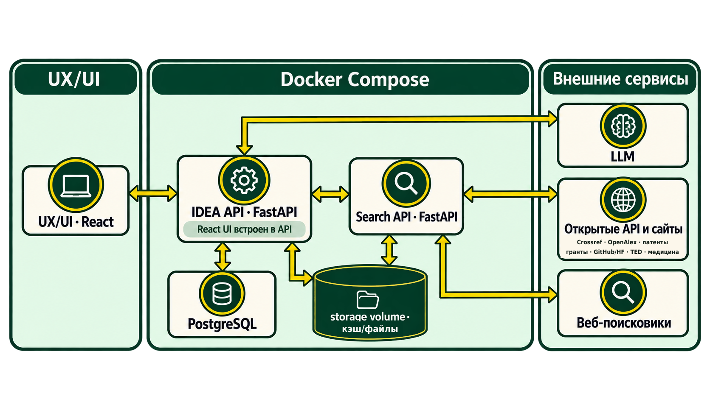

# Архитектура IDEA Radar

Документ описывает архитектуру текущего приложения.
Сценарий запуска и переменные окружения собраны в корневом [README](../README.md).

## Компоненты

IDEA Radar — приложение FastAPI с React-интерфейсом. Радар, ETL и оценивание выполняются в одном
процессе API; отдельными контейнерами Compose являются база PostgreSQL, сервис общего веб-поиска
и SearXNG. Поисковые коннекторы обращаются к внешним открытым источникам напрямую.

```text
Браузер (React)
      │ HTTP: создать запрос / опрашивать состояние
      ▼
FastAPI: API радара + оркестратор запуска
      ├── сервис общего веб-поиска ── SearXNG или выбранный провайдер
      ├── коннекторы источников ───── научные, патентные, денежные, медиа и другие API
      ├── загрузчик и парсер ───────── HTML, текстовые слои PDF, транскрипты
      ├── извлечение кандидатов и проверка доказательств через LLM
      ├── извлечение признаков → логистическая регрессия
      └── хранилище прогонов и источников (PostgreSQL или локальный SQLite)
```



API обслуживает новые и сохранённые исследования. Интерфейс получает состояние запусков
периодическим опросом API. `app/main.py` также сохраняет старый раздел работы с исследовательскими
гипотезами на `/lab` и статическую страницу радара на `/legacy`; у `/lab` отдельная SQLite-база и
документный парсер.

## Путь пользовательского запроса

1. Пользователь вводит тему и при желании уточняет её в чате. Можно начать поиск сразу; выбранные
   направления сохраняются вместе с исходным запросом.
2. Радар формирует план поиска и локализованные формулировки, затем опрашивает общий веб-поиск и
   подходящие специализированные коннекторы параллельно.
3. Найденные документы загружаются, проверяются по дате, нормализуются и дедуплицируются. Ошибка
   одного источника не должна отменять остальные.
4. LLM выделяет кандидатов из корпуса и объединяет дубли. Для каждого кандидата LLM отдельно
   проверяет описание и привязанные цитаты.
5. Параллельно рассчитываются входы действующей логистической регрессии. Результат проверки
   источников и оценка модели вместе определяют вердикт кандидата.
6. В выдаче слабые сигналы сортируются по убыванию оценки, затем список до 15 позиций дополняется
   остальными проверенными кандидатами с сохранением их вердиктов. Если кандидатов не хватило,
   запуск сообщает фактическое количество.

Основная оркестрация — [pipeline.py](../app/radar/pipeline.py), API — [api.py](../app/radar/api.py).

## Поиск и источники

`app/search` предоставляет единый интерфейс над SearXNG, Tavily, Exa, Brave, Yandex Search API,
OpenSERP и веб-поиском OpenRouter. В штатной конфигурации `SEARCH_PROVIDERS=searxng`, а режим
`fallback` перебирает провайдеры по порядку, пока один не вернёт результаты. `fanout` опрашивает
настроенные провайдеры параллельно. В Compose сервис поиска работает отдельно; при пустом
`SEARCH_URL` он может работать в процессе API.

Специализированные каналы включают Bing News, Crossref, arXiv, GDELT и Хабр, встроенные коннекторы
OpenAlex, NIH RePORTER, CORDIS, GitHub, Hugging Face, TED, ClinicalTrials.gov и openFDA, а также
дополнительные коннекторы грантов, венчурных новостей, государственных реестров и патентов.
Часть из них требует ключа, подходит только для отдельных тем или запускается лишь на ветках
поискового плана. `OPENALEX_ENABLED` и `RADAR_EXTRA_CONNECTORS` меняют состав каналов; фактическая
конфигурация задаётся в `.env`. Полный перечень и условия запуска — в [README](../README.md) и
[документации поиска](11-search.md).

## ETL и хранение

Парсер радара в `app/radar/sources.py` извлекает HTML и текстовые документы. Из PDF берётся
текстовый слой; OCR в ETL поиска не выполняется. Транскрипты, обнаруженные у поддерживаемых
аудиоисточников, проходят общий путь обработки. Подробности кэша, повторов, дат и ограничений
хранения описаны в [документе об ETL](09-etl.md).

`RadarStore` хранит записи запусков в `radar_runs`, а источники — в `radar_sources`. В PostgreSQL
payload лежит в JSONB; для локальной разработки без `RADAR_DATABASE_URL` используется SQLite
`storage/radar.db` с JSON в текстовых полях. Отдельная старая подсистема `/lab` использует
`app/db.py` и собственную SQLite-базу.

## Модель и объяснение оценки

В проверенном локальном API загружен артефакт logreg_v1.json: 46 входов, обучающий набор из 1327 строк и порог 0,42. Выбор артефакта зависит от FEATURE_MODEL и SIGNAL_MODEL_PATH; текущая настройка извлечения признаков несовместима с обучающей конфигурацией, о чём API возвращает предупреждение. Подробности — в [настройках моделей](10-model-configuration.md), [обучении](07-training.md) и [отчёте о метриках](12-final-metrics.md).

Признаки извлекаются из датированных свидетельств; числовую оценку считает логистическая
регрессия. В карточке доступны значения и вклады входных признаков. Визуальные и текстовые
объяснения не заменяют первичные документы. Имена моделей намеренно не показываются пользователю
в интерфейсе.

## Время и границы

Для облачного режима стандартный лимит запуска — 18 минут; конфигурация ограничивает его 20
минутами. Для локальной модели допустим больший лимит. Недоступность источника, пустая выдача и
отсутствие даты сохраняются как разные состояния. Годовая диаграмма использует весь доступный
датированный диапазон, но не является полным мировым подсчётом: источники сами ограничивают
периоды и объём результатов.
