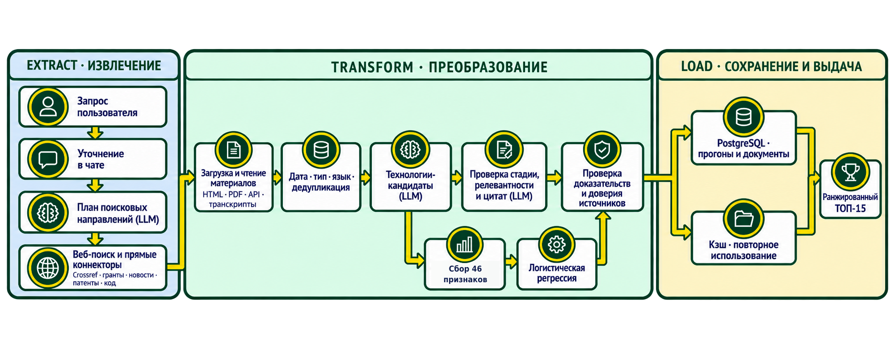

# ETL радара



Документ описывает действующий путь данных для исследования в IDEA Radar. Это часть процесса
поиска внутри FastAPI-приложения, а не отдельный ETL-worker.

```text
Запрос и ветки поиска
  → общий веб-поиск и специализированные коннекторы
  → нормализованные ссылки и метаданные источников
  → загрузка страницы или готового содержимого API
  → извлечение текста и даты, контроль URL и дублей
  → кандидаты, привязанные к источникам и цитатам
  → признаки, оценка модели и проверка доказательств
  → сохранённый прогон, источники, ТОП-кандидатов и статусы
```

## Extract

Общий веб-поиск реализован в `app/search`; его провайдер выбирается через `SEARCH_PROVIDERS`.
Специализированные запросы выполняют `app/radar/open_sources.py`, `research_apis.py` и реестр
`app/radar/connectors/`. Коннекторы возвращают единый формат ссылок с доступными заголовком, URL,
каналом, датой, языком, поставщиком и структурированным событием. Аннотации API, например научных
работ, могут поступить сразу и не требуют повторной загрузки страницы.

Источники, которым нужны ключи или специальные темы, пропускаются, если условие не выполнено.
Новые коннекторы имеют собственный режим включения; конфигурация образца использует
`RADAR_EXTRA_CONNECTORS=all`, но это не гарантирует, что каждый внешний сервис ответит или вернёт
результаты.

## Transform

`app/radar/sources.py` проверяет URL, загружает страницы с ограничением времени и размера, извлекает
текст из HTML и файлов с текстовым слоем PDF, сохраняет метаданные, дату, язык, тип содержимого,
`ingest_sha256`, хэш нормализованного текста и `parser_version`. Для некоторых провайдеров текст
может уже содержаться в ответе поиска. Транскрипты, найденные поддерживаемыми аудиоадаптерами,
также проходят общий формат источника.

Радар сверяет даты с датой среза, нормализует URL, помечает дубли и связывает источники с
кандидатами. На кандидата ссылаются его доказательства и дословные цитаты. Недоступный документ,
неизвестная дата и измеренный нулевой результат сохраняются раздельно.

OCR не входит в ETL поиска: страницы PDF разбираются по доступному текстовому слою. В старом
разделе `/lab` есть отдельный парсер пользовательских документов с кодом OCR и vision-обработкой;
он не является каналом поиска радара. Его статус описан в корневом [README](../README.md).

## Load

`app/radar/store.py` хранит прогоны в `radar_runs`, источники — в `radar_sources`. В PostgreSQL
payload хранится в JSONB; если `RADAR_DATABASE_URL` пуст, локальная разработка и тесты используют
SQLite `storage/radar.db` с сериализованным JSON. Отдельных таблиц для признаков и прогнозов у
радара нет: они лежат в payload запуска и оценок. Данные старого `/lab` находятся в собственной
SQLite-базе `app/db.py`.

Сохраняются извлечённый текст и метаданные, но не исходные байты HTML/PDF. `ingest_sha256` помогает
проверить тело ответа при его обработке, однако сохранённого хэша недостаточно для последующего
повторного парсинга исходного бинарного ответа. Это ограничение важно при трактовке требования ТЗ
о хранении «сырых данных».

## Отказы и повторы

- API-адаптеры применяют лимиты параллельности, обработку временных HTTP-ошибок и охлаждение
  источника после rate limit. Параметры и таймауты могут отличаться между коннекторами.
- Для загрузки страниц действует общий таймаут URL. Повторные сетевые сбои открывают circuit
  breaker домена; после паузы выполняется проверочный запрос.
- Ошибки одного источника или документа фиксируются в статусе и аудите; обработка остальных
  результатов продолжается.
- Общий дедлайн исследования ограничивает всё время запуска. При его исчерпании прогресс и уже
  проверенные результаты сохраняются, запуск может получить статус `partial`.

Тесты парсеров используют записанные ответы API и проверяют разбор, даты, пустые ответы и ошибки
без сетевых вызовов. Живую доступность публичных источников следует оценивать отдельно от unit-тестов.
