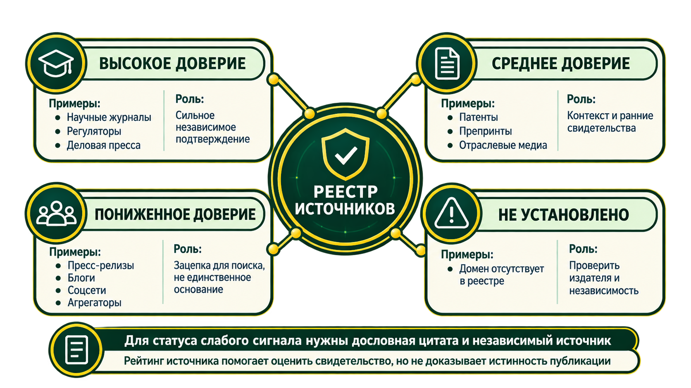

# Поиск источников

Документ описывает текущий поиск IDEA Radar. Фактическая доступность внешних провайдеров зависит
от сети, настроек и ограничений конкретных сервисов; список ниже описывает подключённые способы
поиска, а не гарантирует успешный ответ каждого источника в каждом запуске.

## Два способа обнаружить материалы

1. **Общий веб-поиск** через `app/search`: провайдер настраивается в `SEARCH_PROVIDERS`. В образце
   `.env` используется `searxng`, работающий в Compose. Поддерживаются `tavily`, `exa`, `brave`,
   `yandex`, `openserp` и `openrouter`.
2. **Специализированные каналы** в `app/radar/open_sources.py`, `research_apis.py` и
   `app/radar/connectors/`: научные каталоги, новости, патенты, гранты, финансирование, репозитории,
   закупки и отраслевые источники.

Общий веб-поиск находит страницы, а не гарантирует их полноту. Найденные страницы загружаются
общим fetcher-ом, кроме случаев, когда провайдер уже передал содержимое. Источники и ошибки
фиксируются в прогоне; окончательное подтверждение делается по прочитанным документам и цитатам.

## Общий веб-поиск

| Провайдер | Назначение | Настройка |
|---|---|---|
| SearXNG | Самостоятельно размещённый метапоиск, выбран по умолчанию в `.env.example` | Compose запускает контейнер; ключ не нужен |
| Tavily | Внешний search API | `TAVILY_API_KEY` |
| Exa | Поиск с текстом найденной страницы | `EXA_API_KEY` |
| Brave | Внешний web search API | `BRAVE_API_KEY` |
| Yandex | Yandex Search API v2 | `YANDEX_SEARCH_API_KEY`, `YANDEX_FOLDER_ID` |
| OpenSERP | Самостоятельно размещённый агрегатор поисковиков | профиль Compose `openserp` |
| OpenRouter | Веб-плагин LLM как альтернативный провайдер | `OPENROUTER_API_KEY`, включается явно |

`SEARCH_MODE=fallback` пробует провайдеры по очереди до первой непустой выдачи. `fanout` опрашивает
всех настроенных провайдеров параллельно и объединяет результаты. Ошибка или пустой ответ одного
провайдера не мешают следующему в fallback-режиме. Дату `as_of` после ответа дополнительно
проверяет радар, так как не все движки надёжно фильтруют её на своей стороне.

В Compose сервис поиска вынесен в контейнер `search`; он обращается к SearXNG по внутренней сети.
Если `SEARCH_URL` не задан вне Compose, тот же код поиска запускается в процессе API. Ключи внешних
провайдеров передаются поисковому сервису, а не браузеру.

## Специализированные источники

Набор задаётся `RADAR_OPEN_SOURCES`, `OPENALEX_ENABLED`, `RADAR_EXTRA_CONNECTORS` и
`RADAR_DISABLED_CONNECTORS`. В `.env.example` включены прямые источники и задано
`RADAR_EXTRA_CONNECTORS=all`; отдельные адаптеры всё равно могут быть пропущены из-за отсутствия
ключа, неподходящей темы, исторической даты или ограничений самого API.

**Встроенные коннекторы:** OpenAlex, NIH RePORTER, CORDIS, GitHub, Hugging Face, TED,
ClinicalTrials.gov и openFDA. В образце OpenAlex отключён (`OPENALEX_ENABLED=0`) из-за частых 429;
Crossref и arXiv являются отдельными каналами поиска.

**Дополнительные коннекторы:** Google News (включая венчурные и российские деловые запросы),
Grants.gov, NSF, патенты Google/EPO, Роспатент, SEC EDGAR, EU Funding & Tenders, UKRI,
USAspending (гранты и контракты), TechCrunch, Crunchbase News и Y Combinator. Доступ к отдельным
источникам ограничивается требованием ключа или email и покрытием тематики.

В дополнение используются Bing News, GDELT Global News, arXiv, Хабр и FreePatentsOnline.
При отказе патентного поиска может применяться поиск страниц Google Patents. Google Patents
BigQuery в проекте не используется.

Коннекторы помечают канал и надёжность даты (`strict`, `post`, `none`). В историческом поиске
источники без достоверной даты отключаются; материалы после даты среза отбрасываются. Это
ограничивает утечку сведений из будущего, но не превращает текущий веб в архивную копию прошлого.

## Язык и уточнение темы

Пользователь может сразу запустить исходную тему или уточнить её в чате. План включает обязательный
исходный запрос и выбранные направления; свободные места заполняются близкими формулировками той же
темы. Подтемы не должны добавлять несвязанные области.

В поисковом слое есть 14 приоритетных локалей, а при распознанном языке добавляется язык исходного
запроса. Часть каналов ищет локальные варианты, часть — через многоязычный индекс. Это широкий
мультиязычный поиск, но не буквальный запрос к источникам на всех языках мира. Число языков не
выводится в пользовательском интерфейсе.

## Доклады, видео и транскрипты

Радар обнаруживает страницы докладов и подкастов, RSS/Atom-выпуски с транскриптом, субтитры
VTT/SRT и другие опубликованные текстовые расшифровки. Публичный текст проходит обычный путь
извлечения кандидатов и проверки цитат. YouTube используется для обнаружения и ссылки; сервис не
скачивает видео или аудио YouTube и не обходит закрытые субтитры.

Для разрешённых доменов подкастов можно указать собственный OpenAI-compatible
`/v1/audio/transcriptions` endpoint через `RADAR_AUDIO_TRANSCRIPTION_URL` и домены в
`RADAR_AUDIO_TRANSCRIPTION_ALLOWLIST`. По умолчанию ASR отключён. YouTube и `youtu.be` блокируются
для скачивания независимо от allowlist.

В ETL самого радара OCR нет: для PDF читается текстовый слой. Отдельный OCR/vision-путь старого
раздела `/lab` описан в [корневом README](../README.md).

## Ограничения запуска

В облачном профиле дедлайн по умолчанию — 18 минут, конфигурация допускает не более 20 минут.
Через `.env` можно расширить поиск до 16 направлений, 512 источников и 128 кандидатов; отдельно
настраиваются число языковых формулировок (`SEARCH_MAX_QUERIES`, максимум 15) и выдача на каждую
формулировку (`SEARCH_RESULTS_PER_QUERY`, максимум 20). `.env.example` задаёт экспериментальный
профиль: 8 направлений, до 256 источников, 80 кандидатов, 6 языковых формулировок и 5 результатов
на каждую. Большие значения расширяют объём работы и могут исчерпать 20-минутный дедлайн; реальные
выдачи также ограничены поисковиками и самими источниками.
