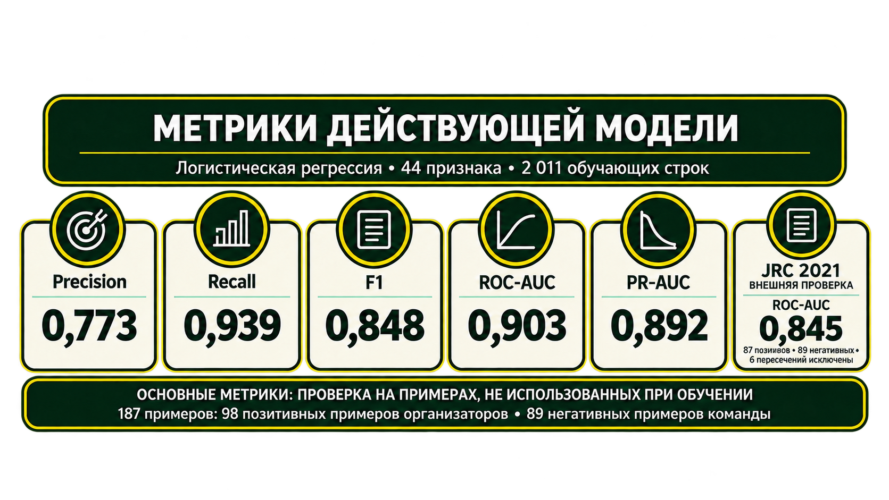

# Метрики действующей модели

20 октября 2026 года локальный API сообщил, что для скоринга загружен app/ml/model/logreg_v1.json: 46 признаков, порог 0,42. Сохранённые метрики относятся к этому артефакту и его обучающему представлению признаков. Текущая локальная конфигурация задаёт для извлечения признаков DeepSeek V4.1 Flash, тогда как артефакт обучен на наборе GPT-5.6 Luna; API также возвращает предупреждение о несовпадении. Поэтому эти цифры описывают проверку артефакта, но не подтверждают качество именно текущего сочетания LLM и логистической регрессии.

В макете выше сохранены прежние значения для версии с 44 входами. Они устарели и не должны использоваться как текущие показатели; актуальные метрики артефакта приведены ниже. Сам PNG — презентационный материал, который требует отдельного обновления.

## Отложенная проверка артефакта

98 положительных примеров организаторов и 89 негативных примеров команды не входили в обучение. Они оцениваются совместно.

| Проверка | n | Precision | Recall | F1 | ROC-AUC | PR-AUC | Brier |
|---|---:|---:|---:|---:|---:|---:|---:|
| Групповая кросс-валидация на обучении | 1327 | 0,672 | 0,938 | 0,783 | 0,922 | 0,799 | 0,106 |
| Отложенная проверка | 187 | 0,786 | 0,939 | 0,856 | 0,918 | 0,911 | 0,120 |

При пороге 0,42 матрица ошибок на отложенной проверке: **TP=92, FN=6, FP=25, TN=64**. У 85,7% позитивных примеров оценка выше 0,75.

## Внешняя проверка JRC

На каталоге JRC 2021 (срез признаков 2021-06-30) ROC-AUC артефакта составляет **0,830** на 93 положительных и 89 отрицательных примерах. После исключения шести пересекающихся позитивов — **0,831** на 87 положительных и 89 отрицательных. В подмножестве AI/ICT (17 положительных и 89 отрицательных) ROC-AUC равен **0,767**.

Исходные числа записаны в app/ml/model/logreg_v1.json и ml/reports/jrc2021_check.json. Отчёт JRC содержит расчёты для нескольких конфигураций; в этом документе приведены только значения активного на проверенном API артефакта.

## Интерпретация

Метрики рассчитаны на конкретных ограниченных выборках и не гарантируют такую же точность на произвольных пользовательских запросах. Результаты живого поиска дополнительно зависят от полноты источников, доступности API, дат, формулировки темы и модели, извлекающей признаки. Вероятность логистической регрессии служит для ранжирования и сама по себе не доказывает истинность утверждений.
